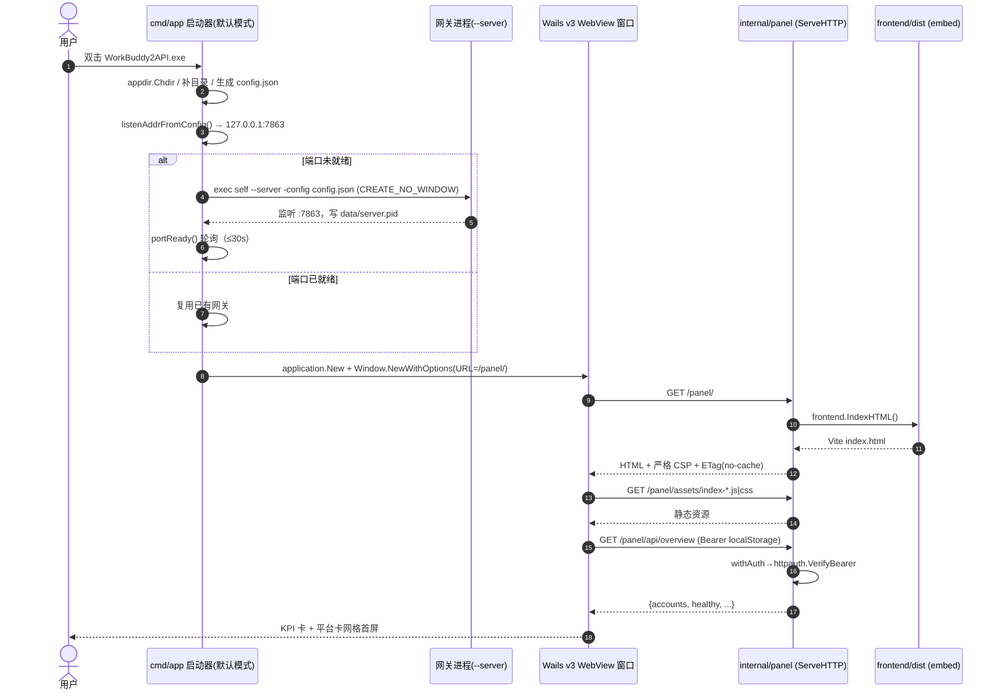
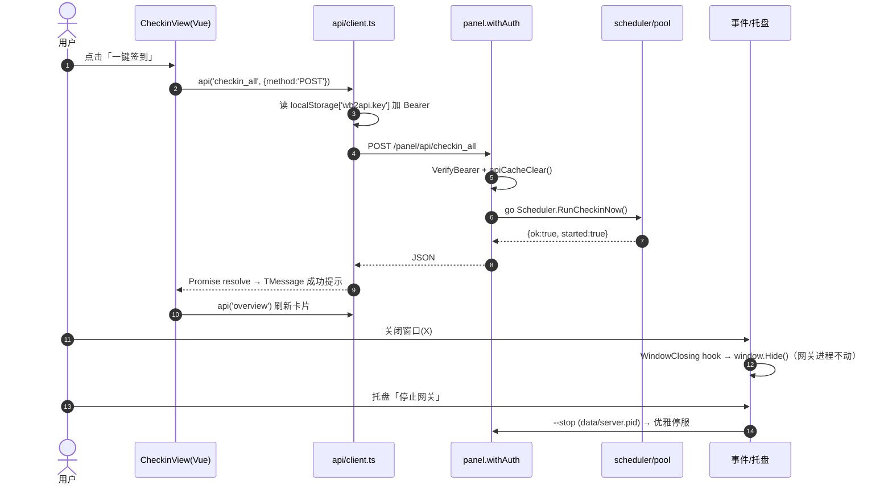
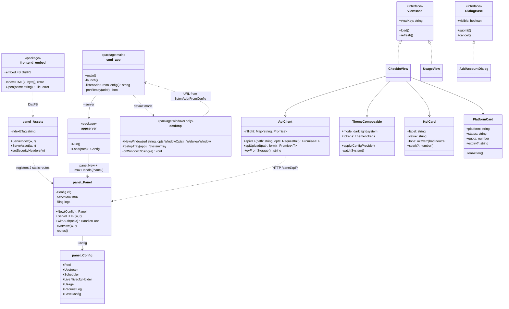
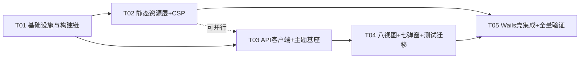
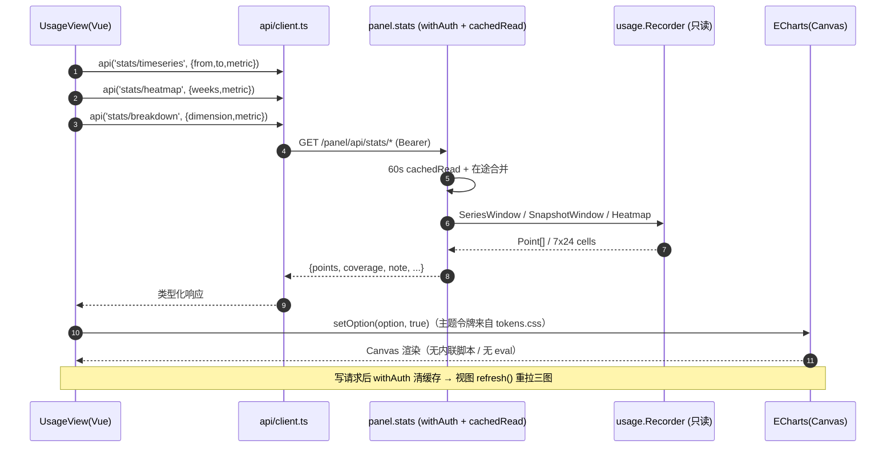
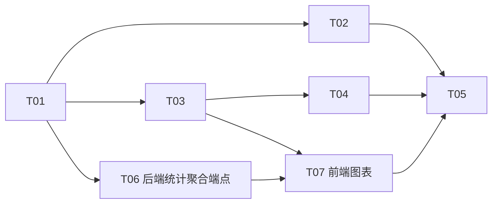

# 架构设计｜WorkBuddy2API Panel 前端重构（Wails v3 · Vue3 · tdesign）

| 项 | 内容 |
| --- | --- |
| 文档语言 | 简体中文 |
| 架构师 | 高见远（Gao）· 架构师 |
| 上游输入 | `deliverables/software-company/PRD-面板重构.md` |
| 项目 | WorkBuddy2API Panel（Go 单 module，`github.com/linguo2625469/workbuddy2api-panel`） |
| 交付形态 | Wails v3.0.0 桌面窗口 + 后台常驻网关 + 同源 Vue3 面板 |
| 技术基线 | Go 1.27.4（go.mod 声明 1.26.0）/ Node 22.22.2 / npm 10.9.7 / Wails CLI v3（需新装 `wails3`） |
| 文档性质 | 只做设计与任务分解，不含实现代码 |

---

## 0. 结论摘要（给赶时间的人）

| 核心问题 | 结论 |
| --- | --- |
| 桌面壳与网关的关系 | ★**双进程、单 exe**：沿用现役 `cmd/app` 的「启动器 + `--server` 隐藏服务」模式，默认模式把「开浏览器」换成「开 Wails WebView 窗口」，窗口加载 `http://127.0.0.1:<listen>/panel/`。网关独立进程，关窗不杀网关。 |
| 前端工程落位 | ★`frontend/` 放在仓库根（Wails 约定）；`frontend/embed.go` 用 `//go:embed all:dist` 暴露 FS，`internal/panel` 在 `/panel/` 与 `/panel/assets/*` 提供它。旧 `index.html`/`app.js` 原冻结归档，QA 通过后经用户拍板一致性全删。 |
| 浏览器访问 | ★**保留且零成本**：UI 由网关同源提供，`http://host:7863/panel/` 天然就是同一套 Vue 面板，不需要维护双份 UI。 |
| 构建链交接 | Vite `base:'/panel/'` → `npm run build` → `frontend/dist` → `//go:embed` 进网关二进制；Wails 窗口不加载 Wails 资产服务器，直接加载网关 URL。严格 CSP 继续由 `internal/panel/index.go` 统一写。 |
| API 对接 | ★**同源 `fetch('/panel/api/...')`**，不用 Wails 绑定：99 个端点、multipart OAuth、轮询流全都不用改；Bearer 仍从 `localStorage['wb2api.key']` 读，401 仍弹访问密钥框。 |
| 主要风险 | 本机 CLI 是 v2 必须换 `wails3`；Wails 桌面构建在 Windows 需 `CGO_ENABLED=1`（现役 build.bat 是 0）；Vite 默认 modulepreload polyfill 是内联脚本，必须关掉；24 个 JS 契约测试需迁到 Vitest。 |

---

## 1. 现状与硬约束

### 1.1 现役结构（实地探查）

- 前端只有两个文件：`internal/panel/index.html`（1792 行，骨架 + 内联 CSS + 全部 DOM）与 `internal/panel/app.js`（6552 行，全部逻辑，原生 JS，无构建链）。
- Go 嵌入层：`internal/panel/index.go`（`go:embed index.html` / `app.js`、构建指纹 `__JS_BUILD__`、严格 CSP、`no-cache` + ETag）、`internal/panel/panel.go`（`routes()` 注册 **99 个** `/panel/api/*` 端点 + `GET /panel/{$}` + `GET /panel/app.js`；`withAuth` 复用 `httpauth.VerifyBearer`，`api_key` 空则放行；写请求清读缓存）。
- 装配：`internal/appserver/main.go` 构造 `panel.New(panel.Config{...})`；`internal/server/handler.go` 挂载 `h.mux.Handle("/panel/", cfg.Panel)`。
- 入口：`cmd/app/main.go`（`//go:build windows`，单文件分发：无参启动器 / `--server` 服务本体 / `--stop` 停服，含端口探测、PID 记录、隐藏窗口启动）；`cmd/server/main.go`（传统网关入口，Dockerfile/旧脚本使用）。
- 契约守卫：`internal/panel/frontend_test.go`（1436 行、24 个 `Test*`：JS 语法、禁内联脚本、格式化/筛选/时间范围、Qoder 分桶、任务中心、配置表单与 CFG_MAP 对齐等）。

### 1.2 全局约束（根 `agents.md`，不得违反）

1. 出站 Transport 单一事实源 `internal/upstream/transport.go`，不得自克隆 DefaultTransport。
2. opencode 通道与号池完全隔离、用量单独入桶；不得改变通道隔离语义。
3. 运行期可变配置只经 `internal/livecfg` 不可变快照（`atomic.Pointer`）。
4. `auths/`、`data/`、`config.json` 含凭据，禁止提交。
5. `archive/` 冻结参考，只读。
6. SSE 转发逐帧 Flush。
7. 验证口径：`go test` + `go vet` + `GOOS=linux CGO_ENABLED=0 go build` 全绿。
8. 新增/删除/重命名文件 → 同步根 `agents.md` 与所属目录 `agents.md`（`internal/panel/agents.md`、`cmd/agents.md`、`archive/agents.md`）。

> 本设计只替换「显示层 + 窗口壳」，`panel.go` 中 99 个 API handler、鉴权、缓存、livecfg 写入路径一律不动；因此上述约束天然保持。

---

## 2. 核心架构决策

### 2.1 桌面壳与 Go 网关的关系

#### 方案对比

| 方案 | 做法 | 启动 | 端口/单文件 | 关窗后网关 | 改造量 | 结论 |
| --- | --- | --- | --- | --- | --- | --- |
| A. 同进程 | Wails `app.Run()` 内把 `appserver.Run()` 改为 goroutine，WebView 用 Wails 资产服务器 | 一个进程 | 单文件天然；但 `appserver.Run()` 里有 `flag.Parse`、`log.Fatal`、`os/signal`、`defer pool.Close()`，改造成可重入很危险 | 关窗即停（除非托盘常驻且生命周期耦合） | 高（网关入口重构 + 99 端点桥接） | 不推荐 |
| **B. 双进程 + 同源 WebView ★** | 现役 `cmd/app` 启动器先用 `--server` 拉起隐藏网关，再开 Wails 窗口加载 `http://127.0.0.1:<port>/panel/` | 一个 exe、两种模式（与现役完全一致，只是把浏览器换成 WebView） | 单文件保持；端口逻辑沿用 `listenAddrFromConfig`/`portReady`；无端口冲突（启动器仍先探测） | 完全不受影响，网关是独立隐藏进程；关窗=隐藏到托盘 | 低（只加窗口壳 + 面板静态资源替换） | **★推荐** |
| C. Wails 资产服务器 + 代理/绑定 | Vue dist 由 Wails embed 在 `http://wails.localhost/`，API 走反向代理或 99 个 Wails 绑定 | 一个进程或双进程 | 跨源 fetch 会遇到 CORS（后端无 CORS 头）；绑定需重写 99 个方法 + multipart/OAuth | 取决于是否双进程 | 最高 | 不推荐 |

#### ★推荐方案 B 的要点

1. **一个 exe，三种模式**（全部在 `cmd/app`）：
   - `--server`：网关本体（隐藏、写 `data/server.pid`、日志到 `data/server.log`）——**代码不变**。
   - `--stop`：停网关——**代码不变**。
   - 无参数（默认）：启动器 + Wails 桌面壳。启动时 `appdir.Chdir()` 到 exe 所在目录，数据目录（auths/data/号池）与 config.json 统一落在 exe 旁，与启动脚本的 cwd 无关；复用首次配置生成、`portReady()`、`exec.Command(self, "--server", "-config", "config.json")`（不设 `cmd.Dir`，子进程继承 exe 目录 cwd）与 `CREATE_NO_WINDOW`；等待端口就绪后不再 `exec.Command("rundll32"...)` 开浏览器，而是创建 Wails 窗口。
2. **窗口加载同源 URL**：`WebviewWindowOptions.URL = "http://127.0.0.1:<port>/panel/"`（Wails v3 `SetURL/URL` 明确支持外部 URL；这里其实是我们自己的本机服务）。Wails 只负责原生窗口、托盘、菜单、对话框；不负责提供静态资源，也不用它的资产服务器与绑定。
3. **关窗不杀网关**：`RegisterHook(events.Common.WindowClosing, ...)` 默认 `window.Hide()`，托盘菜单提供「显示面板」「停止网关」（调用既有 `--stop` 逻辑）、「退出面板」。网关的生命周期与窗口彻底解耦。
4. **为什么不选同进程**：`appserver.Run()` 目前是阻塞式顶层函数，含 flag 解析、`log.Fatalf`、信号处理和 `defer p.Close()/store.Close()`；把它改成可被 Wails 生命周期反复启停，会波及号池/Redis/用量落盘的停机序，收益（少一个进程）远低于风险。
5. **Docker/无头路径不动**：`cmd/server` + `Dockerfile` + `docker-compose.yml` 继续走纯网关；Vue dist 已 embed 在 `internal/panel`，浏览器访问 `/panel/` 自动是新 UI。

> 该方案与现役分发模型同构：现役本来就是「一个 exe 两个进程（启动器 + 服务）」，只是把「打开默认浏览器」这一动作替换为「打开一个 WebView 窗口」。

### 2.2 前端工程落位

#### ★推荐目录（仓库根 `frontend/`，符合 Wails v3 约定）

```
workbuddy2api-panel/
├── frontend/                       # 【新增】Vue3 + tdesign + Vite 工程（Wails 约定位置）
│   ├── package.json
│   ├── package-lock.json
│   ├── tsconfig.json
│   ├── vite.config.ts              # base '/panel/'，dev 9245 + proxy
│   ├── index.html                  # Vite 入口（构建产物 index.html 由 Go 在 /panel/ 提供）
│   ├── embed.go                    # package frontend；//go:embed all:dist → DistFS / DistIndex
│   ├── dist/                       # npm run build 产物（gitignore，保留 .gitkeep 供 go:embed 编译）
│   │   └── .gitkeep
│   ├── src/
│   │   ├── main.ts
│   │   ├── App.vue                 # 三段式壳：侧栏 + 顶栏 + 内容区
│   │   ├── api/
│   │   │   ├── client.ts           # 同源 fetch 封装（Bearer / 401 / 在途合并 / 错误归一）
│   │   │   └── types.ts            # /panel/api/* 响应类型契约（手写，见 §6）
│   │   ├── stores/
│   │   │   ├── panel.ts            # 概览/账号/用量/日志等共享状态（Pinia 或轻量 reactive）
│   │   │   └── session.ts          # api_key、窗口与网关状态
│   │   ├── composables/
│   │   │   ├── useTheme.ts         # 跟随系统 + localStorage('wb2api.theme')
│   │   │   └── useTimeRange.ts     # 今天/昨天/本周/上周/本月/今年 → from/to
│   │   ├── styles/
│   │   │   ├── tokens.css          # PRD §4.2 明暗令牌（唯一色值来源）
│   │   │   └── app.css             # tabular-nums、KPI 语义轨、卡片网格
│   │   ├── components/             # KpiCard / PlatformCard / StatusTag / DataTable / TimeRangeSwitch / ProgressRing ...
│   │   ├── views/                  # CheckinView / UsageView / PackagesView / TasksCenterView /
│   │   │                           # IdeAccountsView / ModelsView / ConfigView / LogsView
│   │   └── dialogs/                # AddAccountDialog(6 tab) / CreditTaskDialog / QoderDeviceDialog /
│   │                               # ClaimHistoryDialog / VoucherDialog / AccessKeyDialog / BuildMismatchDialog
│   └── tests/                      # Vitest：承接现役 frontend_test.go 的 24 项逻辑契约
├── internal/panel/
│   ├── assets.go                   # 【新增】把 frontend.DistFS 挂到 /panel/ 与 /panel/assets/*
│   ├── index.go                    # 【修改】改从 dist 读 index.html；CSP 兼容 Vite；保留安全头/ETag
│   ├── panel.go                    # 【修改】仅替换 2 条静态路由，99 条 API 路由不动
│   ├── dist_routes_test.go         # 【新增】dist/CSP 契约守卫；逻辑断言迁到 frontend/tests
│   └── config.go, ...              # 其余 Go 后端文件一律不动
├── cmd/app/
│   ├── main.go                     # 【修改】默认分支改为启动 Wails 窗口；--server/--stop 不变
│   └── desktop.go                  # 【新增】//go:build windows && !server：Wails App/Window/Tray 装配
├── Taskfile.yml                    # 【新增】dev / frontend:build / build / test / doctor 任务
├── build.bat                       # 【修改】桌面 exe 用 CGO_ENABLED=1；server exe 保持 0
├── start-panel.bat                 # 【修改】提示改为「面板也可在桌面应用中打开」
└── .gitignore                      # 【修改】frontend/dist/* 忽略 + .gitkeep 例外；wails 产物
```

#### 关于落位的三条判断

1. **为什么 `frontend/` 放仓库根**：Wails v3 的 CLI/Taskfile、文档和 60+ 示例都约定根级 `frontend/`（`package.json` 驱动 `npm run build`，`frontend/dist` 为产物）。放这里能让 `wails3 doctor` / 后续接 Wails 资产服务器或服务器构建模式时零迁移成本。Go 侧用 `frontend/embed.go` 这一极小 Go 包解决 `go:embed` 「只能嵌本包目录内文件」的限制（Go 不允许 `../`）。
2. **旧文件处置**：旧 `index.html`/`app.js` 曾移到 `archive/panel-legacy-v1/` 作「8 视图 + 7 弹窗功能对照物」，冻结只读。QA 三轮验收通过（121 前端测试 + CONTRACT_MAP 25 项对照）后，用户拍板一致性全删：归档目录、6 个 legacy Go 测试（`legacyV1Asset()` 只读引用归档）及其文档引用均已删除，同步更新 `archive/agents.md`。**未用「保留旧文件继续 embed」做回退开关**——避免双份 UI 与双份测试维护。
3. **浏览器访问：建议保留**：因为新 UI 由网关同源提供，浏览器访问是免费附赠的，不需要第二套实现。若用户明确不要，可在后续版本加 `config.json` 的 `panel.web_ui=false` 开关（P2），首版不做。

### 2.3 构建链交接

#### 2.3.1 工具安装与命令

```bash
# CLI（本机现为 v2.16 的 wails，必须另装 v3，两者可共存）
go install github.com/wailsapp/wails/v3/cmd/wails3@v3.0.0
wails3 setup
wails3 doctor

# 前端
cd frontend && npm ci
npm run dev                 # Vite dev：127.0.0.1:9245，proxy /panel/api → 127.0.0.1:7863
npm run build               # 产物 frontend/dist/index.html + assets/*.js|css

# 桌面壳（本项目主推 Taskfile，把 Wails 的默认 asset pipeline 显式化）
wails3 generate bindings    # 本项目无 Wails 服务绑定，仅用于校验工具链（可空跑）
npm --prefix frontend run build
go build -trimpath -tags production -ldflags "-s -w -H=windowsgui" -o dist/WorkBuddy2API.exe ./cmd/app
```

`Taskfile.yml`（新增，根目录）任务定义：

| task | 作用 | 关键命令 |
| --- | --- | --- |
| `frontend:dev` | Vite 热更新开发（浏览器直连 9245） | `npm --prefix frontend run dev` |
| `dev` | Wails 窗口 + Vite 热更新（窗口 URL 指向 9245，API 由 Vite proxy 转发） | `wails3 dev`（dev 期窗口 URL 走 `WAILS_VITE_PORT=9245`） |
| `frontend:build` | 产出 dist | `npm --prefix frontend ci && npm --prefix frontend run build` |
| `build` | 桌面 exe | deps: `frontend:build`；`go build -tags production ./cmd/app`（Windows 下 `CGO_ENABLED=1`） |
| `build:server` | 无头网关（CI/Docker） | `go build -tags server ./cmd/server` |
| `test` | 全量校验 | `go test ./internal/... ./frontend/... && go vet ./internal/... ./frontend/... && npm --prefix frontend test -- --run` |

#### 2.3.2 Vite 关键配置（`frontend/vite.config.ts`）

| 项 | 值 | 理由 |
| --- | --- | --- |
| `base` | `'/panel/'` | 构建产物所有资源 URL 为 `/panel/assets/...`，与 Go 路由前缀一致，浏览器与 WebView 都能直接加载。 |
| `build.outDir` | `'dist'` | Wails/本设计共同约定。 |
| `build.modulePreload.polyfill` | `false` | **关键**：Vite 默认注入的 modulepreload polyfill 是内联 `<script>`，会被现役 `script-src 'self'` 拦截导致白屏。 |
| `server.host/port/strictPort` | `127.0.0.1` / `Number(process.env.WAILS_VITE_PORT) \|\| 9245` / `true` | Wails v3 文档要求；`wails3 dev` 通过 `WAILS_VITE_PORT` 公布端口并代理到 `FRONTEND_DEVSERVER_URL`。 |
| `server.proxy` | `'/panel/api': { target: 'http://127.0.0.1:7863', changeOrigin: false }` | 复用现役后端；端口从 `config.json.listen` 派生（开发期默认 7863，可用 `.env.local` 覆盖）。 |
| 可选插件 | `@wailsio/runtime/plugins/vite` | 仅当使用「带类型的 Wails 事件」时才需要；本方案首版不用绑定/事件，**不装插件**，避免强制依赖 bindings 生成顺序。 |

#### 2.3.3 静态资源如何交给 Go（embed）

```go
// frontend/embed.go（设计约定，非实现）
package frontend
//go:embed all:dist
var DistFS embed.FS
func IndexHTML() ([]byte, error) { /* 读 dist/index.html */ }
```

- `internal/panel/assets.go` 用 `fs.Sub(frontend.DistFS, "dist")` 得到子 FS，注册：
  - `GET /panel/{$}` → `dist/index.html`（注入 `__PANEL_BUILD__` 指纹、写 CSP/ETag/no-cache）；
  - `GET /panel/assets/{path...}` → `http.FileServerFS(sub)` 或 `http.ServeContent`；
  - **不注册** `/panel/app.js`（旧路由移除；保留则返回 404，避免新旧脚本混用）。
- `frontend/dist/.gitkeep` 必须入库，并在 `.gitignore` 中写 `frontend/dist/*` + `!frontend/dist/.gitkeep`，否则未执行 `npm run build` 的机器上 `go test ./...` 会因 `go:embed` 找不到目录而编译失败。

#### 2.3.4 CSP 兼容策略

现役 CSP（`internal/panel/index.go`）：
`default-src 'none'; script-src 'self'; style-src 'self' 'unsafe-inline'; connect-src 'self'; img-src 'self' data:; form-action 'none'; frame-ancestors 'none'; base-uri 'none'`

| 调整 | 内容 | 原因 |
| --- | --- | --- |
| 保持 | `script-src 'self'`、`connect-src 'self'`、`frame-ancestors 'none'`、`base-uri 'none'`、`form-action 'none'` | Vite 产物是外链 `<script type="module" crossorigin src="/panel/assets/index-*.js">`，不需要 unsafe-inline；同源 fetch 不受影响。 |
| 保持 | `style-src 'self' 'unsafe-inline'` | tdesign 运行期会注入少量内联 style（弹窗定位等），现役已放行。 |
| 新增 | `font-src 'self' data:` | tdesign icon / 字体资源若以 woff2 data URI 形式出现，避免被 `default-src 'none'` 拦截。 |
| 视情况新增 | `worker-src 'blob:'` | 仅当引入图表 worker 时加（P2）。 |
| 禁止 | `unsafe-eval` | Vue 运行版不要用（Vite build 使用 runtime-only）。 |

守卫：`internal/panel/frontend_test.go` 的 `TestIndexHTMLNoInlineScript` 改为检查 `dist/index.html` 无内联 `<script>`；CI 中 `npm run build` 后运行，Vite 配置改动导致内联脚本回归会立刻红灯。

#### 2.3.5 Wails v3 项目形态说明

Wails v3 模板通常是根 `main.go` + `frontend/` + `build/Taskfile.yml`，`main.go` 里 `//go:embed all:frontend/dist`。本设计**有意不用 Wails 资产服务器**：窗口加载的是网关 `/panel/`，嵌入发生在 `frontend/embed.go` 与 `internal/panel`，`cmd/app` 只做窗口装配。这样 CSP、鉴权、ETag、99 个 API 全部沿用现役 Go 代码，且浏览器访问与桌面访问是同一份 UI。`wails3 build` 的默认流水线若要求根 `main.go`，则以 `Taskfile.yml` 的 `go build -tags production ./cmd/app` 为准（T01 需用 `wails3 build --help` 现场核对；详见 §10 风险 R-1）。

### 2.4 API 对接方式

#### 对比

| 方式 | 鉴权 | 改造量 | 跨端一致性 | 结论 |
| --- | --- | --- | --- | --- |
| **同源 fetch('/panel/api/...') ★** | 复用 `localStorage['wb2api.key']` → `Authorization: Bearer`，与现役 `api()` 完全一致 | 0 后端改动；前端只写 `client.ts` | 桌面 WebView 与浏览器行为完全一致 | **★推荐** |
| fetch 绝对地址 `http://127.0.0.1:7863/...`（从 Wails 资产源发起） | 需透传 Bearer | 若用 Wails 资产源则跨源，后端无 CORS 头 → 浏览器拦截 | 差 | 否决 |
| Wails 绑定（Go Service → TS SDK） | 需重新实现鉴权 | 99 个端点 + multipart 登录 + 长轮询全要包一层；`frontend/bindings/` 生成物还要进构建顺序 | 桌面/浏览器分裂 | 否决（仅 P2 用于窗口控制类桌面能力） |

#### ★推荐实现契约（`frontend/src/api/client.ts`）

- `api<T>(path: string, opts?: RequestInit): Promise<T>` → `fetch('/panel/api/' + path, { headers })`；`path` 不含前导斜杠（如 `'overview'`、`'ide/qoder/accounts'`）。
- 密钥：`localStorage['wb2api.key']`（与现役 `LS_KEY` 同名，保证用户升级后不用重输）；仅 ISO-8859-1 字符才写 Header（现役防御，保留）。
- `401` → 打开 `AccessKeyDialog` 并抛错；非 2xx → `throw new Error(d.error || 'HTTP ' + status)`。
- GET 在途合并（同一 `path` 复用 Promise），写请求独立发出——沿用现役 `_apiInflight` 语义，避免首屏重复打上游。
- multipart 端点（`/panel/api/import/cockpit`）单独提供 `apiUpload()`，不设 `Content-Type`。
- 长轮询端点（login/browser poll）用 `AbortController` 支持取消，避免弹窗关闭后请求悬挂。
- 主题键：`localStorage['wb2api.theme']`（现役 `LS_THEME`，值 `dark`/`light`/`system` 兼容旧值）。

### 2.5 关键时序图（Mermaid）





### 2.6 类图（Mermaid）



---

## 3. 文件清单（新增 / 修改 / 冻结）

| 文件（相对路径） | 动作 | 职责 / 变更点 |
| --- | --- | --- |
| `frontend/package.json` | 新增 | npm scripts（dev/build/test/preview）与依赖声明 |
| `frontend/package-lock.json` | 新增 | 依赖锁定，`npm ci` 可复现 |
| `frontend/vite.config.ts` | 新增 | base `/panel/`、9245 dev、proxy `/panel/api`、关 modulepreload polyfill |
| `frontend/tsconfig.json` | 新增 | TS 严格模式、`paths` 别名（@/） |
| `frontend/index.html` | 新增 | Vite 入口，无内联脚本 |
| `frontend/embed.go` | 新增 | `//go:embed all:dist`，暴露 `DistFS`/`IndexHTML()` |
| `frontend/dist/.gitkeep` | 新增 | 保证 `go:embed` 在未构建机器上可编译 |
| `frontend/src/main.ts`、`App.vue` | 新增 | 应用入口、tdesign `ConfigProvider`、三段式布局、hash 路由 |
| `frontend/src/api/client.ts`、`types.ts` | 新增 | 同源 fetch 封装与响应类型契约 |
| `frontend/src/stores/{panel,session}.ts` | 新增 | 共享状态；`wb2api.key` 会话态 |
| `frontend/src/composables/{useTheme,useTimeRange}.ts` | 新增 | 主题、时间维度 |
| `frontend/src/styles/{tokens,app}.css` | 新增 | PRD 令牌与卡片语言 |
| `frontend/src/components/*.vue` | 新增 | KpiCard / PlatformCard / StatusTag / TimeRangeSwitch / DataTable 等 |
| `frontend/src/views/*.vue` | 新增 | 8 视图 |
| `frontend/src/dialogs/*.vue` | 新增 | 7 类弹窗 |
| `frontend/tests/*.test.ts` | 新增 | Vitest 承接 24 项契约断言 |
| `internal/panel/assets.go` | 新增 | dist 静态路由与 MIME/ETag |
| `internal/panel/index.go` | 修改 | 改读 dist index；CSP 增 `font-src`；保留安全头与指纹 |
| `internal/panel/panel.go` | 修改 | 只改 `routes()` 中 2 条静态路由；99 条 API 注册不动 |
| `internal/panel/dist_routes_test.go` | 新增 | dist HTML/CSP 守卫；逻辑断言迁 Vitest |
| `internal/panel/index.html`、`app.js` | 删除 | 原归档 `archive/panel-legacy-v1/` 及 6 个 legacy Go 测试经用户拍板一致性全删 |
| `cmd/app/main.go` | 修改 | 默认分支：确保网关 + 开 Wails 窗口；`--server`/`--stop` 保持 |
| `cmd/app/desktop.go` | 新增 | `//go:build windows && !server`：Wails App/Window/Tray |
| `Taskfile.yml` | 新增 | dev/build/test/doctor 任务 |
| `build.bat` | 修改 | 桌面 exe 设 `CGO_ENABLED=1`；server exe 保持 0 |
| `start-panel.bat` | 修改 | 启动提示文案（面板同时可在桌面应用打开） |
| `.gitignore` | 修改 | `frontend/dist/*` + `!frontend/dist/.gitkeep`、`bin/`、`*.exe` 补充 |
| `go.mod` / `go.sum` | 修改 | 新增 Wails v3 module（及间接依赖） |
| `agents.md`（根） | 修改 | 入口表增 `cmd/app/desktop.go`、`frontend/`、`Taskfile.yml`；9 条约束不变 |
| `internal/panel/agents.md`、`cmd/agents.md`、`archive/agents.md` | 修改 | 目录职责与文件清单同步（第 7 条裁决检查项） |
| `deliverables/software-company/*.mermaid` | 新增 | 本文两张图的独立文件（类图/时序图） |

**明确不动的文件**：`internal/panel/panel.go` 中 99 个 API handler（`config.go`、`ide_*.go`、`tasks*.go`、`usage_*.go`、`apicache.go`、`routes_repair.go` 等）、`internal/appserver/main.go`、`internal/server/handler.go`、`internal/upstream/*`、`internal/livecfg/*`、`internal/pool/*`、`cmd/server/main.go`、`Dockerfile`、`config.example.json`、`archive/` 其余内容。

---

## 4. 接口契约（前后端）

### 4.1 HTTP 契约（不改）

| 项 | 约定 |
| --- | --- |
| 基路径 | `/panel/api/`（相对路径，跟随 `location.origin`） |
| 方法/路径/字段 | 与现役 99 条完全一致；前端只消费，不新增/不重命名 |
| 鉴权 | `Authorization: Bearer <localStorage['wb2api.key']>`；空 key 放行（后端 `httpauth.VerifyBearer` 同口径）；401 弹访问密钥框 |
| 错误 | 后端 `{ok:false,error:string}`；`client.ts` 统一转成 `Error(message)`；tip 用 tdesign `MessagePlugin` |
| 时间参数 | `from`/`to` 传 unix 秒（前端按本地时区算）或 RFC3339；`hours` 滚动窗口；范围 0..1440 |
| 列表空值 | 后端已保证空数组为 `[]`，前端类型定义为 `T[]` 而非 `T[] | null` |
| 在途合并 | GET 按完整 `path` 合并；写请求不合并 |
| 上传 | `POST /panel/api/import/cockpit` 使用 FormData，不设 Content-Type |
| 读缓存 | 后端任何写请求后 `apiCacheClear()`；前端写成功后主动 `refresh()` 当前视图 |

### 4.2 视图 → 端点映射（迁移清单，验收逐项对照）

| 视图 | 主要端点 | 弹窗/交互 |
| --- | --- | --- |
| 签到池（默认） | `overview`、`checkin_all`、`travel_all`、`activity_all`、`keepalive_all`、`balance_all`、`accounts/{uid}/checkin`、`accounts/{uid}/balance`、`ide/qoder/checkin-status` | 访问密钥、构建失配提示、一键签到/余额刷新 |
| 用量 | `usage`、`usage/official`、`usage/opencode`、`usage/save`、`model_queue`、`ide/trae/limits` | 时间维度切换、维度切换、刷新 |
| 积分构成 | `packages`、`ide/qoder/usage`、`trae/credits`、`school/vouchers` | 开学季券码、Qoder 领取历史 |
| 任务中心 | `accounts/{uid}/tasks*`、`tasks/scan_all`、`tasks/run_queue`、`tasks/queue` | 积分任务、一键完成、队列进度 |
| IDE 账号池 | `ide/{qoder,trae,workbuddy,minimax,doubao}/*`、`login/*`、`login/poll`、`import/cockpit` | 添加账号 6 tab、Qoder 设备/出口、登录轮询 |
| 模型与档位 | `models`、`model_probes`、`model_queue` | 筛选、展开行、实测标注 |
| 配置 | `GET/POST config`、`ide/*/usage` | TForm/TSwitch，保存后提示需重启字段 |
| 运行日志 | `logs`、`request_metrics`、`request_logs` | 时间/outcome/account/model/client_ip/user_agent 筛选，最多 1000 条 |

### 4.3 类型契约管理

- **不用 Wails 生成的绑定类型**：本项目没有 Wails 服务（首版），`/panel/api/*` 的 Go handler 返回 `map[string]any`，Wails 绑定生成器无法为其产出 TS 类型。
- 采用 **`frontend/src/api/types.ts` 手写接口**，按视图分组（Overview/UsageRow/RequestLogEvent/AccountStatus/TaskRow/ModelEntry/ConfigPayload…），字段与 Go handler 的 `writeJSON` 一一对应；类型变更必须同时更新本文件与对应视图的测试 fixture。
- 防止漂移的守卫：Vitest 中对每个视图用固定 fixture 做渲染断言；Go 侧保留 `TestConfigFormMatchesCFGMap` 的等价物（TS `ConfigPayload` 字段 vs `internal/panel/config.go` 的 JSON tag 清单），由 T04 用脚本比对。
- 若未来引入真正桌面能力（窗口/托盘控制），再在 `cmd/app` 注册 Wails Service，用 `wails3 generate bindings` 生成 `frontend/bindings/`，与 `api/types.ts` 分开管理。

---

## 5. 共享约定（Cross-cutting）

| 主题 | 约定 |
| --- | --- |
| 主题令牌 | 唯一色值来源是 `frontend/src/styles/tokens.css`（PRD §4.2 明暗两套 CSS 变量）；暗色为 `:root`，亮色为 `[data-theme=light]`。禁止组件内写死色值。 |
| tdesign 接入 | `main.ts` 中 `<t-config-provider :global-config="...">` 包裹 App；按钮主色/成功/警告/危险映射 `--accent/--ok/--warn/--bad`；圆角 6px、字号 14px 与现役一致；Table/Dialog/Form 通过 `:deep()` 覆写 CSS 变量。 |
| 主题持久化 | `useTheme()`：`system` 用 `matchMedia('(prefers-color-scheme: dark)')` 监听，用户手动切换写 `localStorage['wb2api.theme']`；Webview 与浏览器共用同一 origin，行为一致。 |
| 数值 | 所有观测值 `font-variant-numeric: tabular-nums`；KPI 卡左侧 3px 语义轨；状态徽标只用 ok/warn/bad 三态。 |
| 路由 | hash 路由 `#checkin`（默认）/`#usage`/`#packages`/`#taskscenter`/`#ideaccounts`/`#models`/`#config`/`#logs`，与现役 8 个 hash 完全一致，保证外链/记忆可用。 |
| 命名 | 文件 kebab-case（Vue SFC 用 PascalCase 组件名）；API 路径字符串不写前导斜杠；TS 类型 PascalCase；CSS 类 `wb-` 前缀避免与 tdesign 冲突。 |
| 凭据 | `wb2api.key` 存 localStorage（与现役一致）；不得写入日志、埋点、URL；截图/录屏验收前脱敏。 |
| 安全 | 不改 CSP 以外的响应头；`frame-ancestors 'none'`、`X-Frame-Options: DENY` 保留；前端不得用 `innerHTML` 拼用户数据（用 Vue 插值）。 |
| 测试口径 | `go test ./internal/... ./frontend/... && go vet ./internal/... ./frontend/... && npm --prefix frontend test -- --run && GOOS=linux CGO_ENABLED=0 go build ./...` 全绿；Windows 桌面 exe 另做真机开窗/关窗/托盘验证。 |
| 文档同步 | 每次文件增删 → 根 `agents.md`、`cmd/agents.md`、`internal/panel/agents.md`、`archive/agents.md` 同步更新（全局约束第 8 条）。 |

---

## 6. 依赖包

### 6.1 Go（写入 `go.mod`）

| 包 | 版本 | 用途 | 备注 |
| --- | --- | --- | --- |
| `github.com/wailsapp/wails/v3` | `v3.0.0` | `pkg/application`（App/Window/Tray/事件） | module 路径带 `/v3`；**不是** v2 的 `github.com/wailsapp/wails/v2`；本机 CLI 是 v2.16，需另装 `wails3` |
| 现有依赖（uuid / redis / x/sys / modernc.org/sqlite） | 冻结 | 不动 | `modernc.org/sqlite` 纯 Go，桌面构建无 C SQLite 冲突；Wails 桌面侧自身需要 CGO 与 WebView2 |

> Wails v3 用 Go 1.26 构建，`go.mod` 现为 `go 1.26.0`，已满足，无需升级声明。
> 注意：Windows 桌面 exe 需 `CGO_ENABLED=1`（WebView2 绑定）；`build:server` 与 `GOOS=linux CGO_ENABLED=0 go build` 仍保持 0。桌面 Go 文件加 `//go:build windows && !server`，确保 Linux/CI 的 CGO=0 构建不编译它。

### 6.2 前端 npm（`frontend/package.json`）

| 包 | 建议版本 | 用途 |
| --- | --- | --- |
| `vue` | `^3.5.13` | UI 框架 |
| `tdesign-vue-next` | `^1.10.0` | 组件库（Table/Dialog/Form/Tag/Progress/Statistic…） |
| `tdesign-icons-vue-next` | `^0.4.1` | 图标（或统一内联 SVG stroke=currentColor） |
| `pinia` | `^2.3.0` | 视图间共享状态（可选；小体量可用 reactive 单例） |
| `vue-router` | `^4.5.0` | 可选；本方案用 hash 路由，也可自写 `useHashRoute` 少一个依赖 |
| `vite` | `^6.0.7` | 构建与 dev server（Node 22 兼容） |
| `@vitejs/plugin-vue` | `^5.2.1` | Vue SFC 编译 |
| `typescript` | `~5.7.3` | 类型检查 |
| `vue-tsc` | `^2.2.0` | SFC 类型检查（CI） |
| `vitest` | `^2.1.8` | 承接现役 24 项前端契约测试 |
| `@wailsio/runtime` | `^3.0.0` | 首版可不装；若用 typed events 或 `wails3 dev` 插件时安装 |
| `@wailsio/runtime/plugins/vite` | `^3.0.0` | 仅 typed events 场景；本方案首版不启用 |

> 版本以 `npm view <pkg> version` 现场核对为准；lockfile 入库后 `npm ci` 复现。tdesign 深色主题以 CSS 变量覆写为主，不依赖其私有预处理器。

### 6.3 CLI / 工具

| 工具 | 版本 | 安装命令 |
| --- | --- | --- |
| wails3 CLI | v3.0.0 | `go install github.com/wailsapp/wails/v3/cmd/wails3@v3.0.0` |
| Task（可选，wails3 自带任务运行器） | ≥3.x | `wails3 task <name>` 或系统 `task` |
| Node / npm | 22.22.2 / 10.9.7 | 已就绪 |

---

## 7. 任务分解（按依赖顺序，≤5 项）

> 并行说明：T02 与 T03 均只依赖 T01，可并行；T04 依赖 T03；T05 需等 T02 + T04 完成以做端到端验收。

| 编号 | 任务名 | 源文件（新增/修改） | 依赖 | 优先级 | 验收点 |
| --- | --- | --- | --- | --- | --- |
| **T01** | 项目基础设施与构建链 | `frontend/package.json`、`package-lock.json`、`vite.config.ts`、`tsconfig.json`、`index.html`、`frontend/embed.go`、`frontend/dist/.gitkeep`、`Taskfile.yml`、`build.bat`、`.gitignore`、`go.mod`/`go.sum`、`agents.md`(根)、`cmd/agents.md` | — | P0 | ①`npm ci && npm run build` 生成 `frontend/dist/index.html` + `assets/`；②`go build ./frontend` 在未 npm build 的干净 checkout 也能编译（.gitkeep 生效）；③`wails3 doctor` 无致命项；④`GOOS=linux CGO_ENABLED=0 go build ./...` 绿；⑤根/cmd agents.md 已同步 |
| **T02** | 面板静态资源层 + CSP/契约守卫 | `internal/panel/assets.go`(新)、`internal/panel/index.go`(改)、`internal/panel/panel.go`(仅 2 条静态路由)、`internal/panel/dist_routes_test.go`(新)、`archive/agents.md`、`internal/panel/agents.md` | T01 | P0 | ①`GET /panel/` 返回 Vite index，`GET /panel/assets/*` 200 且 MIME 正确；②99 条 `/panel/api/*` 路由数量与路径不变（脚本比对）；③CSP 含 `font-src 'self' data:`、无 `unsafe-eval`，`dist/index.html` 无内联 script；④ETag/no-cache 行为保持；⑤`go test ./internal/panel` 绿；⑥旧 `index.html`/`app.js` 原归档，QA 通过后经用户拍板连同 legacy 测试一致性全删 |
| **T03** | API 客户端 + 主题/布局基座（可与 T02 并行） | `frontend/src/main.ts`、`App.vue`、`api/client.ts`、`api/types.ts`、`stores/panel.ts`、`stores/session.ts`、`composables/useTheme.ts`、`composables/useTimeRange.ts`、`styles/tokens.css`、`styles/app.css` | T01 | P0 | ①同源 fetch 带 Bearer、401 触发密钥弹窗；②GET 在途合并生效（同一 path 只发一次）；③主题跟随系统 + localStorage 记忆，令牌值与 PRD §4.2 逐项一致；④`wb2api.key`/`wb2api.theme` 与现役键名一致；⑤tdesign ConfigProvider 注入后 Table/Dialog 深色可读；⑥`npm run build` 产物无内联脚本 |
| **T04** | 8 视图 + 7 弹窗迁移 + KPI/卡片化 + 测试迁移 | `frontend/src/views/{Checkin,Usage,Packages,TasksCenter,IdeAccounts,Models,Config,Logs}View.vue`、`frontend/src/dialogs/*`(7 个)、`frontend/src/components/*`(KpiCard/PlatformCard/StatusTag/DataTable/TimeRangeSwitch…)、`frontend/tests/*.test.ts` | T03 | P0 | ①8 个 hash 路由齐全，默认 `#checkin`；②7 类弹窗逐一对齐现役（6tab 添加账号、积分任务、Qoder 设备/出口、领取历史、券码、访问密钥、构建失配）；③各视图 KPI 卡 + 工具卡网格 + 表格等价交互；④现役 24 项契约断言在 Vitest 中全部有对应用例并通过；⑤`vue-tsc` 无类型错误 |
| **T05** | Wails 桌面壳集成 + 全量验证 + 文档收口 | `cmd/app/main.go`(改)、`cmd/app/desktop.go`(新)、`start-panel.bat`(改)、`Taskfile.yml`(补 run 任务)、`agents.md`(根) 与 `internal/panel/agents.md` 终稿、`deliverables/.../*.mermaid` | T02、T04 | P0 | ①双击 exe：网关隐藏启动 → 端口就绪 → WebView 打开 `/panel/` 首屏渲染；②`--server`/`--stop` 行为与现役一致；③关窗隐藏到托盘、网关进程仍在（用 `data/server.pid` 验证）；④托盘「停止网关」可用；⑤浏览器访问 `http://127.0.0.1:7863/panel/` 显示同一 Vue 面板；⑥`go test ./internal/... ./frontend/...`、`go vet`、`npm test`、`GOOS=linux CGO_ENABLED=0 go build ./...` 全绿；⑦真机截图（明暗两主题 + 8 视图）交付 QA |

### 任务依赖图（Mermaid）



---

## 8. 风险与待用户拍板

### 8.1 必须用户拍板（建议值已给出，确认即可开工）

| # | 事项 | 建议 | 影响面 |
| --- | --- | --- | --- |
| Q1 | 是否保留浏览器访问 `http://host:7863/panel/` | ★保留（零成本、同源同 UI） | 若不要，需加 `panel.web_ui=false` 开关（P2），首版不实现 |
| Q2 | 窗口初始尺寸与行为 | ★1280×800、最小 1024×640、居中、可缩放；关窗隐藏到托盘；不做开机自启、不记住窗口位置（首版） | `cmd/app/desktop.go`；要自启需改计划任务脚本 |
| Q3 | 是否启用 Wails 服务器构建模式（`-tags server`） | ★首版**不启用**：网关已由 `cmd/server` 承担 HTTP 服务，服务器模式会引入第二个 HTTP 入口与端口语义冲突；列为 P2 评估 | 若启用，需拆 `application.Options.Server` 与网关监听冲突 |
| Q4 | tokei 增强图表（成本折线/热力图/占比） | ★首版不做（R-12 为 P2），后端无历史时序数据支撑，禁止虚构读数 | 只在用量视图保留后端已有的时序/聚合数据 |
| Q5 | 默认主题 | ★跟随系统优先 + `localStorage` 记忆，暗色为系统暗色时的默认场景（与现役一致） | `useTheme.ts` |
| Q6 | 旧前端归档多久后删除 | ★已执行：QA 三轮验收通过后经用户拍板一致性全删（归档 + 6 个 legacy Go 测试） | `archive/panel-legacy-v1/`（已删除） |

### 8.2 技术风险与缓解

| # | 风险 | 等级 | 缓解措施 |
| --- | --- | --- | --- |
| R-1 | Wails CLI v2 与本方案不兼容；`wails3 build` 的 asset pipeline 是否与「无根 main.go + 自定义 Taskfile」兼容尚未现场验证 | 高 | T01 先 `go install ...@v3.0.0` + `wails3 doctor` + `wails3 build --help` 核对；若 CLI 强制根 `main.go`，改用 `Taskfile.yml` 的 `go build -tags production ./cmd/app`（本设计主路径），Wails 只作为库使用 |
| R-2 | Windows 桌面构建需 `CGO_ENABLED=1`，现役 `build.bat` 写死 0 | 高 | build.bat 拆分：`server` 目标保持 0；`desktop` 目标设 1；Linux CI 保持 `GOOS=linux CGO_ENABLED=0 go build ./...`（desktop 文件 windows tag 隔离） |
| R-3 | Vite modulepreload polyfill / 业务依赖注入内联脚本，触发严格 CSP 白屏 | 高 | `build.modulePreload.polyfill:false`；Go 契约测试扫描 `dist/index.html` 禁内联 `<script>`；QA 用 WebView 右键开发者工具看 console |
| R-4 | WebView 中 Bearer localStorage 在升级后丢失，用户以为面板坏了 | 中 | 沿用现役键名 `wb2api.key`；401 → 访问密钥 Dialog，提供从 `config.json` 复制 api_key 的引导文案 |
| R-5 | 24 个现役 JS 契约测试迁移遗漏，导致「原功能不丢失」无证据 | 高 | T04 建 24 项对照清单（函数名 → Vitest 用例路径），QA 按 PRD §3 R-05 逐项验收；T02 保留 Go 侧 dist/CSP 守卫 |
| R-6 | 单文件 exe 体积增长（Wails + Vue dist embed） | 中 | `-trimpath -ldflags "-s -w -H=windowsgui"`；产物体积基线在 T01 记录，超过 +15MB 需复核；dist 只含必要字体/图片 |
| R-7 | 双进程带来「网关已运行但版本旧」的错配 | 中 | 沿用现役端口探测 + 单实例语义；启动器不主动升级运行中的网关；`--stop` 后重启生效，构建失配提示弹窗保留（R-05） |
| R-8 | 端口被改（config.listen 非 7863）时 Vite proxy 仍打 7863 | 低 | dev 用 `.env.local` 覆盖 `VITE_PANEL_ORIGIN`；生产由 `location.origin` 决定，无硬编码 |
| R-9 | 新增 `frontend/` 包与 `go test ./...` 的 embed 依赖 | 中 | 提交 `frontend/dist/.gitkeep`；CI 顺序固定 `npm run build` → `go test`；`frontend/embed.go` 不含业务逻辑 |
| R-10 | tdesign 深色主题与现役令牌不完全一致 | 中 | 令牌集中在 `tokens.css`，ConfigProvider + `:deep()` 覆写；QA 用明暗双主题截图逐视图比对 PRD §4.2 |
| R-11 | 违反全局约束（Transport/通道隔离/livecfg/凭据） | 低（本设计不触碰） | 所有改动限于显示层与窗口壳；T02 用脚本比对 panel.go API 路由数量与后端 diff 为空 |
| R-20 | 配置与数据目录基准分家（config.json 走启动脚本 cwd、号池走 exe 目录），或 exe 放在只读目录导致写入失败 | 中 | 启动时 `appdir.Chdir()` 到 exe 目录，config.json（相对 ./）、data/ 下 pid/log 与号池（`appdir.Resolve`）统一落在 exe 旁；exe 必须放在可写目录（Docker 走 `cmd/server` + `WORKDIR /app` + 显式 `-config /app/config.json`，绝对路径优先、不受 Chdir 影响）；必要时用 `IDEAUTH_AUTH_DIR` / `IDEAUTH_POOL_DIR` / `DOUBAO_POOL_FILE` 显式覆盖 |

### 8.3 未明确的技术细节（实现期确认，不阻塞开工）

- Wails v3 `WebviewWindowOptions` 的具体字段名（`URL`/`Width`/`Height`/`MinWidth`/`Centered`/`BackgroundColour`）以 `v3.0.0` 的 `pkg/application` 源码为准，T05 对照 `wails3` 示例校正。
- 托盘图标资源：`assets/` 下现有图标是否含 16×16 PNG；若无，T01 补一份（不涉及凭据）。
- `wails3 dev` 与 Vite 9245 的代理细节：若 dev 期 WebView 直连 Vite 导致 `/panel/api` 走 Vite proxy 时丢失 CSP，则 dev 用浏览器 + 9245、仅生产用 Wails 窗口（不影响交付）。

---

## 9. 验收总口径

1. `go test ./internal/... ./frontend/... -count=1` 全绿；
2. `go vet ./internal/... ./frontend/...` 全绿；
3. `GOOS=linux CGO_ENABLED=0 go build ./...` 全绿；
4. `npm --prefix frontend ci && npm --prefix frontend run build && npm --prefix frontend test -- --run` 全绿；
5. Windows 真机：`build.bat` 产出 `dist/WorkBuddy2API.exe`，双击开窗、关窗托盘常驻、`--stop` 可用；
6. 浏览器 `http://127.0.0.1:7863/panel/` 与桌面窗口显示同一 Vue UI，8 视图 + 7 弹窗功能逐项通过 PRD R-05 对照表；
7. 根 `agents.md`、`cmd/agents.md`、`internal/panel/agents.md`、`archive/agents.md` 已同步；`auths/`、`data/`、`config.json` 未入库。

---

> 本设计配套图文件：`deliverables/software-company/class-diagram.mermaid`、`deliverables/software-company/sequence-diagram.mermaid`（内容与 §2.5/§2.6 一致）。

---

# 11. 增量设计｜tokei 增强图表（用户 Q4 改为首版纳入）

> **变更说明**：用户在方案确认时把原 §8.1 的 Q4「tokei 增强图表」从「P2 不做」改为**首版纳入**。本节为增量设计；§1–§9 主体方案全部保持不变。其余拍板维持原结论：浏览器访问**保留**、窗口 1280×800 + 关窗托盘且不自启、旧前端 QA 通过后删除、Wails 服务器构建模式首版不启用、默认主题跟随系统 + 记忆。

## 11.1 现役后端数据基础核查（实地读码 + 现场数据）

### 11.1.1 用量数据：`internal/usage/usage.go`

| 项 | 确切结论 |
| --- | --- |
| 落盘 | `data/usage.json`（路径由 `appserver.usagePathFor(stateFile)` 推出，与 state 同目录），原子替换 + 30s 防抖（`flushInterval = 30 * time.Second`），`fileVersion = 4`，重启恢复 |
| 桶键 | `scope|realm|uid|model|rate`；`scope = "h:2006-01-02T15"` 或 `"d:2006-01-02"`（**本地时区** `time.Local`） |
| 桶字段（JSON 短名） | `s` scope、`r` realm、`u` uid、`m` 裸模型名、`x` 生效倍率、`q` 请求数、`e` 失败数、`p` prompt tokens、`c` completion tokens、`t` total tokens、`l` 延迟累计、`ln` 延迟样本、`v`/`vn` 吐字速率与样本、`cr` 积分累计、`cn` 积分样本数、`ct` 同时有积分与 token 的 token 数、`ch`/`cm` 前缀缓存命中/未命中 |
| 保留策略 | `hourlyKeep = 90 * 24 * time.Hour`；超期小时桶由 `Rollup()` 折叠为日桶，**日桶永久保留**；`maxBuckets = 400_000` 触发即时折叠 |
| 现成聚合 | `Agg`（requests/errors/tokens/credits/credit_samples/cache_hit_rate/avg_latency_ms…）、`Point{T,Scope,Agg}`、`Snapshot{Series,ByRealm,ByAccount,ByModel,ByRealmModel,CreditByAccount,CreditByModel,Totals,Since,WindowFrom,WindowTo,Generated}`、`SnapshotWindow(Window,nicks,currentRate)` |
| 现场文件 | `data/usage.json` 存在（2026-11-20 09:37 写入，5649 B）；样本含 `r:"global"`、`r:"opencode"` 桶；有的桶 `cn:49` 但无 `cr` 字段 → **积分是上游 `usage.credit` 观测，缺字段不是 0 消耗的证据** |

**realm 取值（实测写路径）**：
- `internal/server/handler.go:770` → `Usage.Add(time.Now(), realm, uid, delta.Model, ...)`，常规号池为 `cn` / `global`；
- `internal/server/handler.go:643-657` → 模型前缀分流：`trae`、`minimax`、`qoder-cn` / `qoder-intl` / `qoder`；
- `internal/server/qoder.go:102-106` → `usageRealm` 取模型名冒号前缀；
- `internal/server/opencode.go:377` → `Usage.Add(..., "opencode", "opencode", ...)`，**固定 realm/uid，独立入桶**（通道隔离约束，图表必须保留这个独立性）。

### 11.1.2 请求记录：`internal/reqlog/reqlog.go`

| 项 | 确切结论 |
| --- | --- |
| 落盘 | `data/request-logs/requests-<day>.jsonl`（目录在 `appserver/main.go:352-357` 由 `stateSibling(stateFile,"request-logs")` 得出），权限 0600，队列 1024，满则丢弃计数不阻塞请求 |
| Event 字段 | `time`(RFC3339Nano)、`request_id`、`path`、`account`(昵称+uid8 标签)、`model`、`status`、`ok`、`outcome`(`success`/`http_error`/`stream_error`/`interrupted`)、`duration_ms`、`ttfb_ms`、`attempts`、`prompt_tokens`、`completion_tokens`、`total_tokens`、`credit`、`credit_known`、`cache_hit_tokens`、`cache_miss_tokens`、`stream`、`body_bytes`、`gateway_prepare_ms`、`client_ip`、`user_agent` |
| 保留/上限 | `RetentionDays` 默认 **7 天**（`config.example.json` 也是 7）、`MaxBytes` 默认 100 MiB、`FileMaxBytes` 16 MiB；`prune()` 按 mtime + 天数 + 总大小删旧文件；内存 `recent` 只留最近 100 条 |
| 读取限制 | `ReadArchive(limit, Filter)` 上限 **1000 条**，字符串字段包含匹配，`From/To` 闭区间 |
| 现场文件 | `data/request-logs/requests-2026-11-13.jsonl`、`...-19.jsonl`、`...-20.jsonl` 均存在；单条样本含 `path:"/opencode/v1/chat/completions"`、`outcome:"success"`、`total_tokens:174365` |
| 结论 | **已有**按日期（文件名 + `time`）、按模型（`model`）、按状态（`status`/`outcome`）的持久化；但 7 天 + 1000 条上限使其只适合「运行日志」明细，不适合 90 天长周期图表 → 长周期一律以 usage 桶为准 |

### 11.1.3 三件事的数据充分性判定

| 图表 | 数据是否够用 | 判定与来源 |
| --- | --- | --- |
| **成本/用量趋势折线** | ✅ 够用 | `usage.SnapshotWindow().Series` 已给出按小时/按日的 `credits`、`total_tokens`、`requests`；90 天内小时粒度、更早日粒度。无需新增落盘。注意：`credits` 是积分观测而非货币成本，单点 `cn`/`credit_samples` 为 0 时须标注「上游未回该维度」 |
| **周热力图（星期 × 小时）** | ⚠️ 一维序列不够 | `Snapshot.Series` 只按时间片聚合，无法回答「周一 9 点通常耗多少」。**需新增只读聚合方法**（遍历 `h:` 桶按 weekday×hour 重聚合），**不新增落盘、不改写路径**。90 天前的日桶没有小时信息 → 自动降级并显式标注 |
| **工具/模型用量占比** | ✅ 够用 | `Snapshot.ByRealm`（工具维：cn/global/trae/minimax/qoder-*/opencode）、`ByModel`、`CreditByModel`、`Totals` 已有；只需在面板层做「realm → 中文工具名」映射 + Top-N 收敛 + 百分比计算 |

> **豆包说明**：豆包是签到池（只有 `/panel/api/ide/doubao/*`），Gateway 无 `Usage.Add` 调用 → 没有网关用量桶。占比图必须在响应中给出 `excluded` 说明，不能让用户误以为漏数据。

---

## 11.2 新增只读聚合端点契约

### 11.2.1 通用约定（不动 99 个 handler）

- 新增文件 `internal/panel/stats.go` 定义 `registerStatsRoutes(mux *http.ServeMux)`；`internal/panel/panel.go` 的 `routes()` 末尾**只加一行** `p.registerStatsRoutes(p.mux)`，现有 99 条注册语句一字不改。
- 3 个端点全部 `GET`，统一 `p.withAuth(p.cachedRead(statsCacheTTL, handler))`，`statsCacheTTL = 60 * time.Second`（新常量，放在 `stats.go`）；写请求仍由既有 `withAuth → apiCacheClear()` 清空全部缓存，一致性语义不变。
- 时间入参复用现役 `parseTimeParam()`（unix 秒 / 毫秒 / RFC3339 / `2006-01-02T15:04`）；非法值按现役语义忽略该侧边界，不报错。
- 不新增响应头；CSP、Bearer 鉴权、`livecfg`、Transport、号池、opencode 隔离语义全部不变。
- 新增只读方法集中在 `internal/usage/stats.go`：`SeriesWindow(w Window, realm string) []Point`（可选 realm 过滤，与 `SnapshotWindow` 共用聚合 helper，避免两份口径漂移；单测锁定同一入参下 `Totals` 与原方法一致）和 `Heatmap(opts HeatmapOptions) HeatmapResult`。**不修改** `Add/Rollup/flush/load`。

### 11.2.2 `GET /panel/api/stats/timeseries`（成本/用量趋势）

| 入参 | 类型 | 默认 | 说明 |
| --- | --- | --- | --- |
| `from` / `to` | unix 秒或 RFC3339 | 空 | 显式区间；与 `hours` 二选一，显式优先 |
| `hours` | int | `168` | 滚动窗口，0 = 全部历史（日桶）；上限 2160（90 天） |
| `granularity` | `auto\|hour\|day` | `auto` | auto：`hours<=168` 用 hour，否则 day |
| `metric` | `credits\|tokens\|requests` | `credits` | 折线纵轴；credits 为积分观测 |
| `realm` | string | 空 | 可选工具过滤（`cn/global/trae/minimax/qoder-cn/qoder-intl/qoder/opencode`） |

```json
{
  "metric": "credits",
  "granularity": "hour",
  "timezone": "Local",
  "from": "2026-11-13T00:00:00+08:00",
  "to": "2026-11-20T09:00:00+08:00",
  "points": [
    {"t": "2026-11-20T08", "label": "11-20 08时", "value": 12.5, "scope": "hour", "samples": 49, "requests": 52}
  ],
  "coverage": {
    "hour_buckets_from": "2026-08-22",
    "days_without_hour_data": 0,
    "missing_intervals": 3,
    "credit_samples": 1234
  },
  "note": "积分为上游 usage.credit 观测值，非货币成本；samples=0 表示上游未回该维度。",
  "source": "usage",
  "generated": "2026-11-20T09:40:00+08:00"
}
```

实现要点：从 `SeriesWindow` 取点 → 按 `granularity` 把 `h:` 归并为日（求 credits/tokens/requests 之和、samples 之和）→ 时间轴补零点（`missing_intervals` 计数）→ 本地时间标签化；上限 2160 点，超出由 granularity 强制 day。

### 11.2.3 `GET /panel/api/stats/heatmap`（星期 × 小时热力图）

| 入参 | 类型 | 默认 | 说明 |
| --- | --- | --- | --- |
| `weeks` | int | `8` | 回溯周数，1–13；受 90 天小时桶上限约束 |
| `metric` | `credits\|tokens\|requests` | `tokens` | 着色维度 |
| `realm` | string | 空 | 可选工具过滤 |

```json
{
  "weeks": 8,
  "from": "2026-09-28",
  "to": "2026-11-22",
  "timezone": "Local",
  "cells": [
    {"weekday": 1, "hour": 9, "value": 88.4, "requests": 12, "samples": 12, "days": 8}
  ],
  "max": 88.4,
  "coverage": {
    "hourly_retention_days": 90,
    "oldest_hour_date": "2026-08-22",
    "days_without_hour_data": 0,
    "scope": "hour"
  },
  "note": "星期×小时矩阵，按所选周数聚合；超过 90 天仅有日桶、无小时粒度，不参与着色。",
  "generated": "2026-11-20T09:40:00+08:00"
}
```

实现要点：`Heatmap()` 在 `usage` 包内持锁遍历 `Scope` 以 `h:` 开头的桶，按 `time.ParseInLocation(hourLayout, ..., time.Local).Weekday()` + `Hour()` 聚合（Go 的 `Weekday()` Sunday=0，前端展示映射为周一为首列）；返回固定 7×24 = 168 个 cell（无数据 value=0 且 `days=0`），另附 `coverage`；**不读日桶**（没有小时信息），`days_without_hour_data` 告知前端是否有降级区间。

### 11.2.4 `GET /panel/api/stats/breakdown`（工具/模型占比）

| 入参 | 类型 | 默认 | 说明 |
| --- | --- | --- | --- |
| `from` / `to` / `hours` | 同 timeseries | `hours=168` | 同口径 |
| `dimension` | `tool\|model\|account` | `tool` | `tool` = 按 realm 映射 |
| `metric` | `tokens\|credits\|requests` | `tokens` | 占比分母 |

```json
{
  "dimension": "tool",
  "metric": "tokens",
  "total": 1234567,
  "items": [
    {"key": "opencode", "label": "OpenCode（独立转发通道）", "tokens": 900000, "credits": 0, "requests": 120, "share_percent": 72.9, "credit_samples": 0},
    {"key": "global", "label": "WorkBuddy · Global", "tokens": 300000, "credits": 12.5, "requests": 80, "share_percent": 24.3, "credit_samples": 49}
  ],
  "excluded": [
    {"key": "doubao", "reason": "签到池，无网关用量桶；不在占比统计内"}
  ],
  "note": "占比按所选 metric 计算；credits 为积分观测值，非货币成本。opencode 独立入桶，不与号池合并。",
  "generated": "2026-11-20T09:40:00+08:00"
}
```

realm → label 映射（面板层，纯展示）：`cn`→WorkBuddy · CN、`global`→WorkBuddy · Global、`trae`→Trae、`minimax`→MiniMax、`qoder`/`qoder-cn`/`qoder-intl`→Qoder（双区保留子标签）、`opencode`→OpenCode（独立转发通道）。Top 8 + 「其他」聚合，避免饼图碎片的返回体膨胀与误读。

### 11.2.5 图表接口时序（Mermaid）



---

## 11.3 最小补数据方案（只在数据不够处）

| 缺口 | 首版方案（推荐） | 不做什么 |
| --- | --- | --- |
| 热力图需要 weekday×hour 二维 | 新增 `internal/usage/stats.go` 的**只读** `Heatmap()`，在现有 `h:` 桶上重聚合；零新增落盘、零写路径改动 | 不改 `Add/Rollup`，不新建数据文件 |
| 90 天前的小时粒度已被折叠为日桶 | `coverage.days_without_hour_data` + `note` 明示「仅近 90 天参与热力图」，前端对无数据区间淡出而非补零伪造 | 不反推、不插值、不用日桶冒充小时桶 |
| 货币成本（¥/$） | 不提供。首版只展示 `credits`（上游 `usage.credit` 实测）+ `credit_samples` 覆盖率 + 文案标注 | 不写死单价、不用当前倍率回算历史金额（会随配置漂移，属于虚构读数） |
| 豆包无网关用量 | `breakdown.excluded` 显式列出原因 | 不在占比图里塞 0 值假装“有数据” |
| （P2 备选）若日后坚持 >90 天小时热力图 | 在 `usage.Add` 旁路追加 `data/heatmap_daily.json`（按日 weekday×hour 累加），沿用现有 30s flush ticker，**保持现有 bucket 语义不变**；只能改善未来数据，不能回填历史 | 首版不做，需用户再次拍板 |

---

## 11.4 图表库选型

| 候选 | 版本 | 结论 |
| --- | --- | --- |
| **ECharts + vue-echarts ★** | `echarts ^5.6.0`、`vue-echarts ^7.0.3` | **★推荐**。唯一同时覆盖折线 + 热力 + 占比的成熟 Vue3 方案；用 `echarts/core` 按需引入，Canvas 渲染，不引入 `echarts-gl` |
| `tdesign-vue-next` 自带图表 | — | tdesign 提供 Table/Progress/Tag 等展示组件，**不提供通用折线/热力/饼图组件**；因此由 tdesign 负责卡片容器、筛选与主题，ECharts 只负责绘图 |
| `echarts-gl` / 3D | — | 禁用：已知存在 `new Function` 动态代码路径，会与严格 CSP 冲突 |

**按需引入（设计约定，非实现）**：只 `use(LineChart, HeatmapChart, PieChart, GridComponent, TooltipComponent, VisualMapComponent, LegendComponent, CanvasRenderer)`；禁止 `import * as echarts from 'echarts'` 全量引入；渐变用字面量 `new echarts.graphic.LinearGradient({...})`，**禁止 `new Function('return ...')`**（现役 CSP `script-src 'self'` 会拦截并与 `unsafe-eval` 风险挂钩）；tooltip 使用函数引用或字符串模板，不传可执行字符串。

**与 `tokens.css` 联动**：`frontend/src/components/charts/EChartBase.vue` 在挂载与主题切换时通过 `getComputedStyle(document.documentElement).getPropertyValue('--accent' | '--ok' | '--warn' | '--bad' | '--line' | '--ink-2' | '--ink-3')` 读取当前令牌（保持 tokens.css 为唯一色值源），组装 option 后 `setOption(option, true)`；`backgroundColor: 'transparent'`，让卡片面 `--surface` 透出；容器 `ResizeObserver` + Wails 窗口尺寸变化自动 `resize()`。暗/亮切换由 `useTheme()` 触发，图表无需独立主题状态。

**CSP 验收**：沿用 T02 的「dist/index.html 无内联 `<script>`」守卫；T07 验收增加 WebView 真机开发者工具 console 零 CSP 报错；降级预案为手写 SVG 折线/热力组件（仍是外链模块脚本，不破坏 CSP）。

---

## 11.5 增量文件清单

| 文件 | 动作 | 职责 |
| --- | --- | --- |
| `internal/usage/stats.go` | 新增 | `SeriesWindow()` / `Heatmap()` 只读聚合；与 `SnapshotWindow` 共用 helper |
| `internal/usage/stats_test.go` | 新增 | 口径一致性、时区、90 天降级、7×24 cell 数、opencode 独立 realm |
| `internal/panel/stats.go` | 新增 | 3 个端点、参数校验、零填充、realm→label、Top-N、响应注释 |
| `internal/panel/stats_test.go` | 新增 | JSON 契约、鉴权、缓存键、写后清缓存、空数据/极值 |
| `internal/panel/panel.go` | 修改（仅 1 行） | `routes()` 末尾追加 `p.registerStatsRoutes(p.mux)` |
| `internal/panel/agents.md`、`internal/agents.md` | 修改 | 登记新增文件与 `usage/agents.md`（若索引所指文件缺失则新建） |
| `frontend/src/api/stats.ts` | 新增 | `fetchStatsTimeseries/Heatmap/Breakdown` 类型化封装 |
| `frontend/src/api/types.ts` | 修改 | 追加 `TimeseriesResponse/HeatmapResponse/BreakdownResponse` 及 `coverage/note` |
| `frontend/src/components/charts/EChartBase.vue` | 新增 | 按需注册、主题令牌注入、resize、CSP 安全配置 |
| `frontend/src/components/charts/{TrendChart,HeatmapChart,BreakdownChart}.vue` | 新增 | 三类图表组件 |
| `frontend/src/views/UsageView.vue` | 修改 | 在 KPI 卡与明细表之间插入三图卡片区，接时间维度切换 |
| `frontend/src/styles/app.css` | 修改 | 图表卡片高度、图例/热力格样式 |
| `frontend/tests/stats.test.ts` | 新增 | 入参映射、零填充、主题联动、CSP 禁用项（无 `new Function`）静态扫描 |
| `frontend/package.json` / `package-lock.json` | 修改 | 新增 echarts、vue-echarts 依赖 |

明确不动：`internal/reqlog/*`、`internal/server/*`、`internal/appserver/main.go`、`internal/upstream/*`、`internal/livecfg/*`、99 个现役 handler、鉴权与缓存实现。

---

## 11.6 任务列表更新（新增 T06 / T07）

| 编号 | 任务名 | 源文件 | 依赖 | 优先级 | 验收点 |
| --- | --- | --- | --- | --- | --- |
| **T06** | 后端统计聚合端点 | `internal/usage/stats.go`(新)、`stats_test.go`(新)、`internal/panel/stats.go`(新)、`stats_test.go`(新)、`panel.go`(仅加 1 行注册)、`internal/panel/agents.md`、`internal/agents.md`(+`usage/agents.md` 视情况) | **T01** + 本节数据核查（已完成） | P0（首版纳入） | ① 3 个端点均需 Bearer、空 key 放行语义不变；② 同一入参下 `stats/timeseries` 的 totals 与 `/panel/api/usage` 一致；③ heatmap 返回 168 个 cell 且 >90 天区间有 `coverage` 标注；④ breakdown 中 opencode 独立成项、doubao 出现在 `excluded`；⑤ 99 个原 handler 注册数不变；⑥ `go test ./internal/...`、`go vet` 全绿 |
| **T07** | 前端图表组件与主题联动 | `frontend/src/api/stats.ts`(新)、`types.ts`(改)、`components/charts/*`(新)、`views/UsageView.vue`(改)、`styles/app.css`(改)、`tests/stats.test.ts`(新)、`package.json`/lock(改) | **T03 + T06** | P0（首版纳入） | ① 用量视图展示趋势折线 + 周热力 + 工具占比三张卡片，跟随时间维度控件；② 明/暗主题切换后图表配色与令牌一致；③ Vite 产物无内联脚本，WebView 真机 console 无 CSP 报错；④ 无 `new Function`/`eval`/`echarts-gl`；⑤ 400k 桶模拟数据下三图首屏 < 1s；⑥ `npm test` 与 `vue-tsc` 全绿 |

**依赖关系更新**：



> **T05 验收点追加一项**：原 §7 的 T05 第 6 条之后增加「三张图表在 Wails WebView 与浏览器中均可渲染、主题切换正常、无 CSP 报错」；T05 仍需等待 T07 完成后才能做最终端到端验收。T02/T03 仍可并行；T06 与 T02/T03 也可并行。

---

## 11.7 风险增补（图表专属）

| # | 风险 | 等级 | 缓解 |
| --- | --- | --- | --- |
| R-12 | 聚合口径漂移：图表数字与 `/panel/api/usage` 卡片对不上 | 高 | 共用 `aggAcc`/`SeriesWindow` helper，不另写聚合；T06 验收用同一入参断言 totals 相等；时间窗口解析统一 `parseTimeParam` |
| R-13 | 数据量/性能：400k 桶下热力图全表扫描、趋势图 2160 点 | 中 | 60s `cachedRead` + 在途合并；热力图只扫 `h:` 桶且 `weeks<=13`；趋势图强制上限 2160 点；占比图 Top 8 + 其他；400k 桶压测目标 <200ms |
| R-14 | 时区口径：usage 桶按 `time.Local`，reqlog `time` 带偏移，浏览器可能跨时区 | 中 | 响应显式返回 `timezone`/`from`/`to`；前端按 `t` 字符串展示，不做二次 `new Date()` 位移；标注「以网关本地时区为准」；桌面与网关同机时天然一致 |
| R-15 | CSP：ECharts 若引入动态代码/内联 SVG 导致白屏 | 高 | 仅 core + 3 图 + CanvasRenderer；禁 `echarts-gl`；禁用 `new Function`/`eval`（Vitest 静态扫描 + T07 真机 console 冒烟）；降级为手写 SVG 组件 |
| R-16 | 数据透明：把积分当货币成本、`credit_samples=0` 误读为 0 消耗 | 高 | 响应与 UI 双层 `note`；折线点带 `samples`；不提供货币估算；不回算历史单价 |
| R-17 | 豆包无用量桶、用户误以为图表漏数据 | 低 | `breakdown.excluded` 明示原因；占比图下方固定说明文案 |
| R-18 | 通道隔离被图表破坏（opencode 混入号池占比） | 高 | `realm=opencode` 独立 label 与独立桶；契约测试断言其不被合并进 cn/global；前端不得做「工具总和 = 账号池总量」的假设 |
| R-19 | 新增 Go 依赖/文件触发 agents.md 同步遗漏 | 低 | T06 验收清单包含 `internal/agents.md`、`internal/panel/agents.md` 更新；`usage/agents.md` 缺失时新建 |

---

## 11.8 验收增补（图表）

1. `go test ./internal/usage/... ./internal/panel/... -count=1` 全绿；
2. 三个端点在 `api_key` 为空/非空两种配置下行为与现役 `/panel/api/*` 一致；
3. 用 `data/usage.json` 现场文件跑一次，折线点数、热力 cell 数、占比总和（Top8+其他 = 100%）符合契约；
4. 明/暗主题切换 + WebView 真机 console 无 CSP 报错；`npm test`、`vue-tsc`、`GOOS=linux CGO_ENABLED=0 go build ./...` 全绿；
5. 交付三图在明/暗两主题下的截图给 QA，附 `coverage`/`note` 的透明标注说明。
